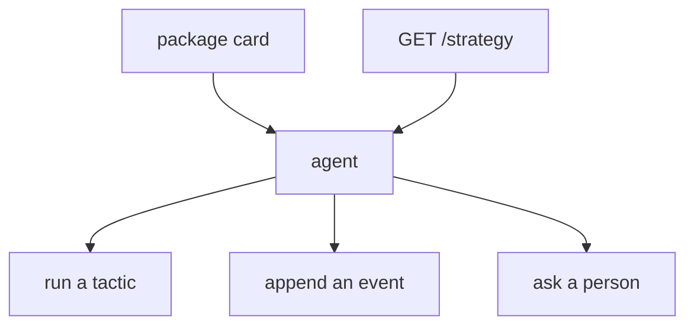

# Agents and handoff

AAAX does not run agents or tell them how to reason. It makes a strategy
legible and callable, so an agent can take it over: a coding agent that
has to understand and extend a system, or a running agent that should use
one as a tool. The handoff contract is metadata plus endpoints: what an
agent needs to choose an action is in the resource table, and every action
is an HTTP route with a typed envelope.



Here are the requests an agent makes when it meets a support desk package
it has never seen: it reads the strategy, checks a tactic's contract, acts,
and leaves a note for the people who run the desk.

```python title="handoff.py"
from pathlib import Path

from fastapi.testclient import TestClient

from aaax import create_strategy_app, strategy_from_package

Path("desk").mkdir()
Path("desk/desk_tactics.py").write_text(
    '''
from pydantic import BaseModel


class Ticket(BaseModel):
    text: str


def triage(ticket: Ticket) -> dict:
    """Pick a queue for a support ticket."""
    urgent = "down" in ticket.text.lower()
    return {"queue": "oncall" if urgent else "support"}
'''
)
Path("desk/lllm.toml").write_text(  # (1)!
    '''
[package]
org = "acme"
name = "desk"
description = "Route support tickets."

[tactics.triage]
entry = "desk_tactics:triage"
description = "Pick a queue for a support ticket."

[channels.notes]
description = "Observations that agents leave for people."

[services.api]
tactic = "triage"
description = "The entry point for callers."

[card]
summary = "Routes tickets to support or on-call."
safety = "Never closes tickets; a person confirms."
'''
)
client = TestClient(create_strategy_app(strategy_from_package("desk")))

info = client.get("/strategy").json()  # (2)!
print(info["metadata"]["card"]["safety"])
#> Never closes tickets; a person confirms.
for resource in info["resources"]:
    print(resource["kind"], resource["name"], resource["ref"])
    #> package desk lllm://acme/desk
    #> tactic triage lllm://acme/desk/tactics/triage
    #> channel notes lllm://acme/desk/channels/notes
    #> service api lllm://acme/desk/services/api

contract = client.get("/tactics/triage/info").json()  # (3)!
print(contract["input_schema"]["required"])
#> ['text']

ticket = {"input": {"text": "Checkout is down"}}
reply = client.post("/resources/api/invoke", json=ticket).json()  # (4)!
print(reply["output"])
#> {'queue': 'oncall'}
note = {"kind": "note", "payload": "Routed a checkout outage to on-call."}
client.post("/channels/notes/events", json={"input": note})  # (5)!
notes = client.get("/channels/notes/events").json()["output"]
print([event["payload"] for event in notes])
#> ['Routed a checkout outage to on-call.']
```

1. An LLLM package: a tactic, a channel, a service that fronts the tactic,
   and a `[card]` written for readers, people and agents alike.
2. One request returns the whole table: the card from the manifest, and
   every resource with its kind, local name, and `lllm://` ref.
3. Before calling, the agent reads the tactic's contract. Its input schema
   comes from the function's `Ticket` annotation.
4. The service names the tactic it fronts, so invoking the service runs
   the tactic.
5. The channel is how the agent hands work back: people, other agents, or
   a processor read the same events.

## What an agent can read

These reads change nothing, so an agent can explore before it acts:

| Route | Tells an agent |
| --- | --- |
| `/strategy` | The name, description, and metadata (a package strategy's card included), and every resource |
| `/resources`, `/tactics`, `/channels`, `/packages` | The same resource records, all or by kind |
| `/tactics/{name}/info` | One tactic's contract: description, input and output schemas, capabilities, `package_ref` |
| `/openapi.json`, `/tactics/{name}/openapi.json`, `/network/openapi.json` | OpenAPI documents for the strategy's routes, a tactic, and the store |

A resource record has a `kind`, a local `name` (the one in URLs), a `ref`
that stays the same wherever the resource is mounted, an `entrypoint`, a
`description`, and `metadata`. A package fills the metadata from its
manifest, so the record says how the pieces relate:

| Kind | `metadata` holds |
| --- | --- |
| `package` | `package` (as `org/name`), `version`, `path`, `primary`, `card` |
| `tactic` | `runtime`, `input` and `output` schema names, `examples` |
| `service` | `tactic` or `tactics` it fronts, `subscribes`, `publishes`, `transport` |
| `channel` | `schema`, `form`, and the `store` folder |
| `run` | The `services`, `tactics`, `channels`, and `snapshots` that run together |
| `doc`, `example`, `asset` | `path`, plus `title`, `command`, or `media_type` |
| `config` | `schema` and `defaults` |

Every package resource also records `package`, `version`, and `resource`,
its name in the manifest before any prefix; keys without a value are left
out. A card holds `summary`, `tags`, `safety`, `latency`, and
`suggested_commands`. `/tactics/{name}/info` describes the loaded tactic
itself: its description and examples come from the tactic's code (a
function's docstring, for one), or from the manifest's `description` and
`examples` when the code has none.

## Before anything runs

A coding agent working in a repository can read the same table without
serving anything. `aaax inspect TARGET --json` prints the `StrategyInfo`
that `GET /strategy` returns, and it imports no package code, opens no
store, and needs neither SSSN nor API keys. A few lines in the agent's
instructions, such as an `AGENTS.md`, are enough to hand the strategy over:

```text
This repository's strategy is in strategy.py.
- See what it mounts: aaax inspect strategy.py --json
- Serve it: aaax serve strategy.py (http://127.0.0.1:8400)
- Read a tactic's input schema first: GET /tactics/<name>/info
- Call a tactic: POST /tactics/<name>/run with {"input": ...}
- Leave notes for people: POST /channels/notes/events
```

## What an agent can do

| Action | Route |
| --- | --- |
| Run one tactic | `POST /tactics/{name}/run` |
| Call a service, or any resource by name | `POST /resources/{name}/invoke` |
| Append an observation to a channel | `POST /channels/{name}/events` |
| Read what happened since a cursor | `GET /channels/{name}/events?after_cursor=N` |
| Run the strategy's own operation | `POST /run` |

A package service that names one `tactic` runs it when invoked, as `api`
did above. AAAX does not start service processes from a manifest: other
services are records, and invoking one echoes it back. Failures come back
in the services error envelope, with a `type` and a `message`, and the
status tells an agent what to do next: fix the input after a 400, check the
name after a 404, and retry or ask a person after a 500
([Errors](serving.md#errors)).

## Hand tactics to another program

Each mounted tactic is a standard LLLM tactic service, so `RemoteTactic`
turns it back into a tactic in another program, and
[`tactic_as_function`](https://lllm.one/tools/#tactics-as-tools) turns that
into a tool an LLLM agent can call:

```python title="remote.py"
import asyncio

import httpx
from lllm import RemoteTactic
from lllm.runtimes.native import tactic_as_function

from aaax import Strategy, create_strategy_app


def triage(text: str) -> str:
    """Route a support ticket to a queue."""
    return "oncall" if "outage" in text.lower() else "support"


app = create_strategy_app(Strategy("desk").tactic("triage", handler=triage))
remote = RemoteTactic(
    "http://desk.internal:8400/tactics/triage",  # (1)!
    input_type=str,
    async_transport=httpx.ASGITransport(app=app),  # (2)!
)


async def main():
    contract = await remote.afetch_info()
    print(contract.name, "|", contract.description)
    #> triage | Route a support ticket to a queue.
    print(await remote.arun("Total outage in eu-west"))
    #> oncall
    return contract


contract = asyncio.run(main())
tool = tactic_as_function(remote, description=contract.description)
print(tool.name, tool.properties)  # (3)!
#> triage {'task': {'type': 'string'}}
```

1. The URL of one tactic in the strategy app. `RemoteTactic` posts to
   `.../run` and reads `.../info`, and takes its name from the last path
   segment.
2. Only for this example: the transport sends requests to the app in this
   process. Against a running strategy, pass the URL alone.
3. The tool an agent sees: the tactic's name, its description, and one
   `task` parameter typed by the input schema. Put it in a prompt's
   `function_list`, and the agent can call the strategy's tactic.

To name the tactic by its ref instead of its URL, bind the ref in the
calling project's `.lllm/config.toml`, and `lllm.Resolver` returns a
`RemoteTactic` for it
([Local configuration](https://lllm.one/packages/#local-configuration)):

```toml title=".lllm/config.toml"
[refs."lllm://acme/desk/tactics/triage"]
url = "http://127.0.0.1:8400/tactics/triage"
```

## Agent cards on the hub

The [LLLM Hub](https://lllm.one/publishing/#cards) describes a package
before anyone has it. `lllm hub agent-card ORG/NAME` renders a card for
coding agents from a published package's `lllm.toml`: the summary, how to
set the package up and serve it, the API keys it needs, the `[card]` notes,
every resource with its ref and entry, and a starting `.lllm/config.toml`.
AAAX describes the same package once it is mounted and running, with local
names and live routes.

The refs connect the two. A resource's `ref` in `/strategy` is the ref on
the card, so an agent that read the card finds each resource in the
strategy. The `[card]` table is in the package resource's
`metadata["card"]`, and also in the strategy's own metadata when the
strategy is one package, as with `aaax serve FOLDER`. The config template
binds each tactic ref to a URL like `http://127.0.0.1:8000/tactics/<name>`,
the route shape a strategy serves: change the port to 8400 for `aaax
serve`, and add the prefix to the name for a package mounted with one.

A package downloaded from the hub is a folder with an `lllm.toml`, so
`aaax inspect` and `aaax serve` take it as is
([Use a package from the hub](https://lllm.one/publishing/#use-a-package-from-the-hub)).
AAAX does not check or load API keys: `aaax serve` neither checks a
package's `[requirements.api_keys]` nor reads keys that `lllm setup`
stored, so export the keys in the environment before serving a package
whose tactics call a model.
