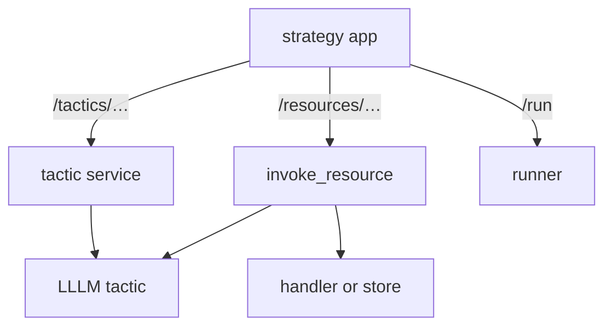

# How AAAX works

A strategy is a table of named resources, plus the code that makes some of
them callable, served as one FastAPI app. AAAX keeps the table and the app,
and everything you mount stays what it was: a tactic is still an LLLM
tactic, a package is still an LLLM package, and a channel still lives in an
SSSN store. That split is the design. AAAX is a thin strategy shell
built on LLLM, so a part behaves the same inside a strategy as it does on
its own.

| Piece | What it is | Comes from | Guide |
| --- | --- | --- | --- |
| **Strategy** | The application: a name, resources, and an optional runner | AAAX | [Strategies](strategies.md) |
| **Resource** | One named part: kind, local name, ref, description, metadata | AAAX | [Resources](resources.md) |
| **Handler** | The Python that makes a resource callable | You | [Resources](resources.md#handlers) |
| **Tactic** | A program with a typed boundary | LLLM | [Tactics](https://lllm.one/tactics/) |
| **Package** | A folder described by an `lllm.toml` | LLLM | [Packages](packages.md) |
| **Channel** | A named stream of events in a store | SSSN | [Channels](channels.md) |

## One tactic, three routes

A strategy app answers on several routes, and each hands the request to a
different part. Here one tactic is reached two ways, and the runner calls it
together with a service:

```python title="routes.py"
from fastapi.testclient import TestClient
from lllm import Tactic

from aaax import Strategy, create_strategy_app


class Triage(Tactic):
    """Route a support ticket to a queue."""

    name = "triage"

    def call(self, text: str, *, context=None) -> dict:  # (1)!
        queue = "oncall" if "outage" in text.lower() else "support"
        return {"queue": queue, "request": context.request_id}


def page(queue: str, context=None) -> str:  # (2)!
    return f"paged {queue} for {context['user']}"


strategy = Strategy("desk", description="The support desk as one API.")
strategy.add_tactic(Triage())
strategy.service("pager", handler=page)


@strategy.runner  # (3)!
async def run(ticket: str, context=None) -> dict:
    routed = await strategy.invoke_resource("triage", ticket)
    queue = routed["queue"]
    paged = await strategy.invoke_resource("pager", queue, context=context)
    return {"queue": queue, "pager": paged}


client = TestClient(create_strategy_app(strategy))
body = {"input": "Total outage", "context": {"request_id": "req-7"}}
print(client.post("/tactics/triage/run", json=body).json())  # (4)!
"""
{
    'output': {'queue': 'oncall', 'request': 'req-7'},
    'request_id': 'req-7',
    'tactic': 'triage',
}
"""
print(client.post("/resources/triage/invoke", json=body).json())  # (5)!
"""
{
    'output': {'queue': 'oncall', 'request': 'req-7'},
    'strategy': 'desk',
    'metadata': {'resource': 'triage', 'endpoint': 'resource'},
}
"""
body = {"input": "Total outage", "context": {"user": "ada"}}
print(client.post("/run", json=body).json()["output"])  # (6)!
#> {'queue': 'oncall', 'pager': 'paged oncall for ada'}
```

1. `call()` declares `context`, so it receives the request's LLLM
   `CallContext`, with ids for tracing, tags, and metadata.
2. A service resource with a handler. Handlers of resources other than
   tactics get the context as a plain dict.
3. The runner is the strategy's own command, `POST /run`. It reaches the
   other resources by their local names.
4. `/tactics/triage/` is the tactic's own service, built by LLLM's
   `create_tactic_app`, so the envelopes, ids, and errors are LLLM's: the
   same answer `lllm serve` would give.
5. The same tactic through the strategy's route for any resource. It runs
   exactly as on its tactic route, with a `CallContext`, and answers in the
   strategy's envelope.
6. `/run` gives its context to the runner as a dict, and the runner passes
   it on to the pager.

## How a request flows



| Route | Goes to |
| --- | --- |
| `/tactics/{name}/run`, `/stream`, `/info` | The tactic, through LLLM's tactic service |
| `POST /resources/{name}/invoke` | The resource's tactic, its handler, or its store channel; a resource with none of these echoes its record |
| `GET`, `POST /channels/{name}/events` | A channel resource's handler or store channel |
| `POST /run` | The runner; without one, the strategy's table |
| `/network/...` | SSSN's store API, when the strategy has an SSSN store |
| `GET /strategy`, `/resources`, `/tactics`, `/channels`, `/packages` | The table itself |

A tactic resource gets a `CallContext` on both of its routes, so it sees a
request the same way whichever route it came by. The request's `context`
there has the shape of a `CallContext` (`request_id`, `trace_id`, `caller`,
`tags`, `metadata`, and a few more): put your own values in `metadata`,
because other keys are dropped. The runner and other handlers get the
`context` as a plain dict, as it was sent. [Serving](serving.md) has every
route, envelope, and status code.

## Names and refs

Every resource has a local name, and most have a ref:

- The **name** says where the resource is in this strategy. It is unique,
  it is a URL path segment, and routes and `invoke_resource` use it:
  `kb.search`.
- The **ref** says what the resource is, wherever it runs:
  `lllm://acme/knowledge-base/tactics/search`. A package gives each of its
  resources one, and mounting the package under a prefix does not change
  it.

So two packages can both have a `search` tactic: mount them as `kb.search`
and `docs.search`, and their refs still tell them apart. Code that calls a
tactic by its ref keeps working when the tactic moves into a strategy
([Packages](packages.md#call-a-mounted-tactic-by-ref)).
[Resources](resources.md#local-names-and-refs) has the naming rules.

## Nothing runs until it is used

Building a strategy only fills in its table. Package code is imported, and
the channel store opened, when the strategy is served or a resource is
first used. That makes inspection safe: `aaax inspect ./some-package` reads
the manifest without running any of its code, and needs no SSSN even when
the package declares channels.

## What AAAX owns

AAAX gathers parts and serves them; it does not run models or store events.

| Concern | Owner |
| --- | --- |
| The strategy: resource table, names, handlers, runner | AAAX |
| The strategy app and its routes | AAAX |
| Loading strategy files and package folders; `aaax` and `lllm shell` | AAAX |
| Tactics, agents, models, tools, and `CallContext` | [LLLM](https://lllm.one/) |
| Serving each tactic (`create_tactic_app`) | [LLLM](https://lllm.one/serving/) |
| Packages, `lllm.toml`, refs, and the hub | [LLLM](https://lllm.one/packages/) |
| Channels, events, stores, and the store API | [SSSN](https://sssn.one/) |
| Authentication, deployment, scaling, and scheduling | Your platform |

Because the strategy app is a plain FastAPI app, the last row is ordinary
FastAPI work: add middleware, put a gateway in front, or run it with any
ASGI server.
