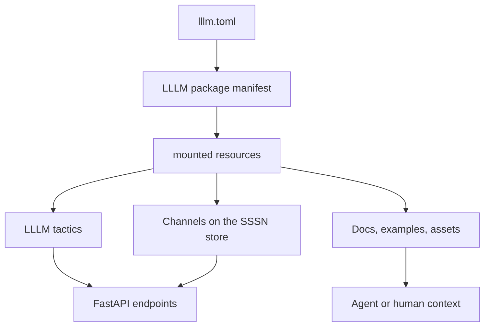

# Package Composition

AAAX composes packages by mounting manifest resources into a shell. A package
remains the unit of publication and discovery, on the LLLM hub or in a folder.
A strategy is the shell session that chooses local names, binds handlers, and
serves endpoints.

Package composition is optional. You can use AAAX with a hand-written strategy,
with one package, with several packages, or with only the LLLM tactics and
SSSN channels that the shell actually needs.



## Direct Package Shell

`strategy_from_package(path)` creates one shell from one package:

```python
from aaax import strategy_from_package


shell = strategy_from_package("packages/analyst-pack")
```

The shell name defaults to `package.name`. Package card metadata is copied onto
the strategy metadata and package resource.

## Imported Packages

`Strategy.use_package(path)` mounts one package into an existing shell:

```python
from aaax import Strategy


shell = Strategy("analysis-shell")
shell.use_package("packages/sources", prefix="sources")
shell.use_package("packages/analysts", prefix="analysts")
```

Prefixes only affect local shell names. The original `lllm://` refs stay in
the resource records. A package whose names clash with resources already in the
shell is rejected before anything is added; the `ValueError` suggests a prefix.

## Binding

When `bind=True`, AAAX binds:

- Python tactic entrypoints, loaded as LLLM tactics with `coerce_tactic`.
- Package channels to the strategy's SSSN channel store, one store per strategy.
- Services that declare one `tactic` to the same tactic handler.

Binding is lazy. Building or inspecting the shell imports no package code and
creates no store; serving it, calling `strategy.tactics()`, or invoking a
resource does.

Use `bind=False` when you only want the mount table and metadata: no handlers,
no store, and no tactic routes.

```python
shell.use_package("packages/remote-only", bind=False)
```

That is useful for remote packages, planning tools, and agent handoff contexts
where another process will resolve the actual service URLs.
