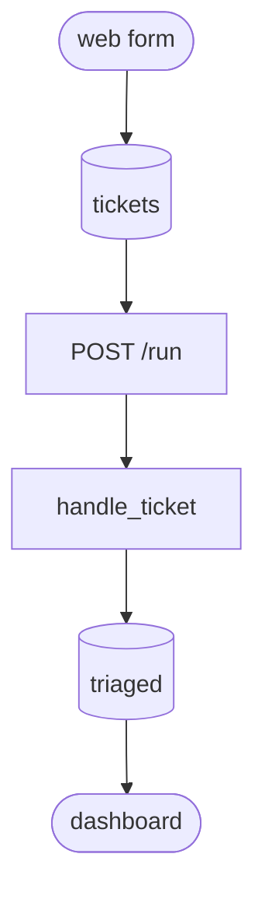

# Support desk

A support desk takes tickets from a web form, routes each one to a queue,
writes a one-line summary for whoever picks it up, and keeps a record of
every decision. This program is one strategy: two tactics and two
channels, served as one API. The form appends tickets to a channel and
returns at once, `POST /run` triages everything new, and dashboards and
agents read the results from a second channel.



## The program

```python title="support_desk.py"
from typing import Literal

from fastapi.testclient import TestClient
from lllm import Tactic
from pydantic import BaseModel
from sssn import LocalStore, TacticProcessor

from aaax import Strategy, create_strategy_app


class Ticket(BaseModel):  # (1)!
    customer: str
    text: str


class Route(BaseModel):
    queue: Literal["oncall", "billing", "bugs", "general"]
    priority: Literal["high", "normal"]


KEYWORDS = {
    "oncall": ("down", "outage", "unreachable"),
    "billing": ("charged", "refund", "invoice"),
    "bugs": ("error", "crash", "broken"),
}


class Triage(Tactic):  # (2)!
    """Route a support ticket to a queue."""

    name = "triage"
    input_model = Ticket
    output_model = Route

    def call(self, ticket: Ticket) -> Route:
        text = ticket.text.lower()
        for queue, words in KEYWORDS.items():
            if any(word in text for word in words):
                priority = "high" if queue == "oncall" else "normal"
                return Route(queue=queue, priority=priority)
        return Route(queue="general", priority="normal")


def summarize(ticket: Ticket) -> str:
    """Keep the first sentence of a ticket."""
    return ticket.text.split(". ")[0].rstrip(".")


triage = Triage()


def handle_ticket(ticket: Ticket) -> dict:  # (3)!
    """Triage and summarize one ticket."""
    route = triage(ticket)
    return {
        "customer": ticket.customer,
        "queue": route.queue,
        "priority": route.priority,
        "summary": summarize(ticket),
    }


strategy = Strategy("support-desk", description="Triage incoming tickets.")
strategy.add_tactic(triage)
strategy.tactic("summarize", handler=summarize)
strategy.tactic("handle_ticket", handler=handle_ticket)
strategy.channel("tickets", description="Tickets from the web form.")
strategy.channel("triaged", description="One result per ticket.")
strategy.attach_store(LocalStore(".lllm/network"))  # (4)!

processor = TacticProcessor(  # (5)!
    strategy.tactics()["handle_ticket"],
    strategy.store,
    source="tickets",
    sink="triaged",
    errors="record",
)


@strategy.runner
async def process_new_tickets() -> dict:  # (6)!
    events = await processor.aprocess()
    errors = [event for event in events if event.kind == "error"]
    return {"processed": len(events), "errors": len(errors)}


# A client: the web form, a scheduler, and a dashboard.

client = TestClient(create_strategy_app(strategy))
tickets = [
    {"customer": "ada", "text": "I was charged twice. Please refund one."},
    {"customer": "lin", "text": "The dashboard is down for our team."},
    {"customer": "sam", "text": "How do I export my data to CSV?"},
    {"customer": "kim"},  # (7)!
]
ids = []
for ticket in tickets:
    body = {"input": {"kind": "ticket", "payload": ticket}}
    event = client.post("/channels/tickets/events", json=body).json()
    ids.append(event["output"]["id"])

print(client.post("/run", json={}).json()["output"])
#> {'processed': 4, 'errors': 1}

url = "/channels/triaged/events"
results = client.get(url, params={"kind": "result"}).json()["output"]
for result in results:
    payload = result["payload"]
    print(payload["customer"], payload["queue"], payload["priority"])
    #> ada billing normal
    #> lin oncall high
    #> sam general normal
errors = client.get(url, params={"kind": "error"}).json()["output"]
print(errors[0]["payload"]["type"], errors[0]["parent_ids"] == [ids[3]])
#> SchemaError True

print(client.post("/run", json={}).json()["output"])  # (8)!
#> {'processed': 0, 'errors': 0}

body = {"input": {"customer": "jo", "text": "The app crashes on login."}}
print(client.post("/tactics/triage/run", json=body).json()["output"])
#> {'queue': 'bugs', 'priority': 'normal'}
```

1. The models are the contract. `Ticket` validates input on every route,
   and both schemas appear in `/tactics/triage/info`.
2. Triage by keywords, so the example runs offline. A tactic whose agent
   asks a model fits the same slot without other changes
   ([Tactics](https://lllm.one/tactics/)).
3. A plain function is a tactic too: AAAX wraps it with `lllm.as_tactic`,
   and the `Ticket` annotation becomes its input schema.
4. One store holds both channels. Building the app creates them.
5. SSSN's processor reads `tickets` through a named subscription, runs
   `handle_ticket` on each payload, and appends the result to `triaged`.
   With `errors="record"`, a ticket that fails becomes an `error` event
   instead of stopping the run.
6. The runner is `POST /run`. It takes no input, so it is called without
   one.
7. A malformed ticket, with no `text`. It becomes an `error` event whose
   `parent_ids` point at the ticket, so a dashboard can show which one
   failed and why.
8. The subscription remembers its place, so a second run finds nothing
   new.

## Run it as a server

Put everything above the client comment in `strategy.py`. The loader finds
the module-level `strategy`:

```bash
aaax inspect strategy.py
aaax serve strategy.py --port 8400
```

```bash
curl -X POST localhost:8400/channels/tickets/events \
  -H 'content-type: application/json' \
  -d '{"input": {"kind": "ticket",
       "payload": {"customer": "ada", "text": "Refund please."}}}'
curl -X POST localhost:8400/run -H 'content-type: application/json' -d '{}'
curl localhost:8400/channels/triaged/events
```

A scheduler, such as a cron job that posts to `/run` every minute, keeps
the queue moving. Each run picks up where the last one stopped, because
they share the subscription. Run one at a time: SSSN's processor handles
each event at least once, and two runs at the same moment could triage a
ticket twice ([Processing](https://sssn.one/processing/)).

## How it works

**Tickets are events, not requests.** The form appends to a channel and is
done. It never waits for triage, and a ticket is kept even when triage
fails. The channel is also the audit log: every ticket and every decision
stays in the store, linked by `parent_ids`.

**The processor is the worker.** `TacticProcessor` does the bookkeeping a
worker needs: it remembers the last event it handled, acknowledges an
event only after the result is written, and records failures as data.
The strategy only decides when it runs.

**One API, every piece reachable.** The same app serves the runner at
`/run`, each tactic at `/tactics/<name>/run` for one-off calls and tests,
the channels at `/channels/<name>/events`, and the whole store to SSSN
clients at `/network/`. `GET /strategy` describes all of it to an agent
([Agents and handoff](../agents.md)).

**Plain parts.** `Triage` is an LLLM tactic, `summarize` and
`handle_ticket` are functions, and the store is SSSN's. AAAX adds the
names, the routes, and the one store they share.

## Make it yours

- Replace `Triage.call()` with an agent that reads the ticket. Keep
  `Route` as its output model, and the rest of the program stays the same.
- Put the store on another machine with `RemoteStore(url)`, so several
  strategies share the channels ([Channels](../channels.md)).
- Move the tactics into an LLLM package and mount it with
  `strategy.use_package()` ([Packages](../packages.md)).
- Add a middleware that checks a token before serving it beyond localhost
  ([Serving](../serving.md#your-own-server)).
