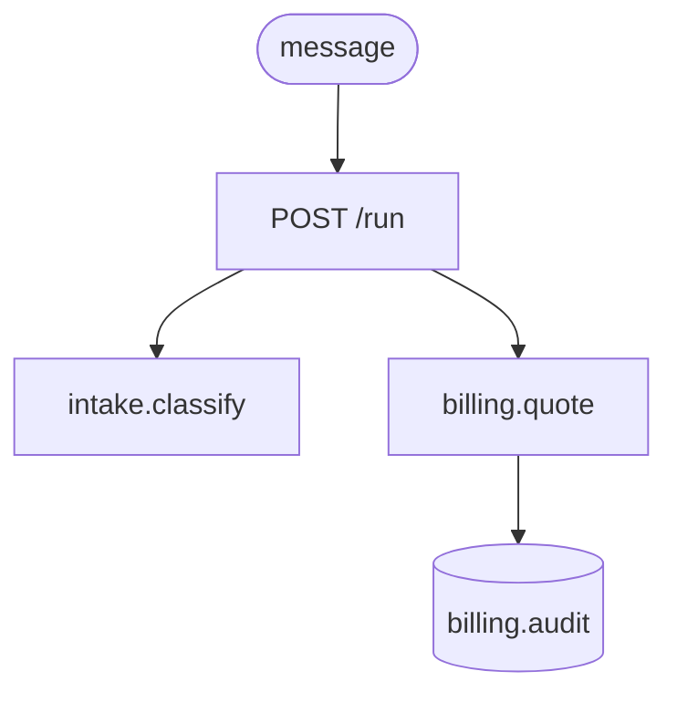

# Two packages, one API

An operations team has two LLLM packages. `intake`, downloaded from the
hub, labels customer messages; `billing`, their own, quotes refunds and
keeps an audit channel. They want one service: a message comes in, gets a
label, and a refund request gets a quote that is recorded. This program
mounts both packages into one strategy, gives them one store, and adds the
runner that connects them.



## The program

```python title="two_packages.py"
import sys
from pathlib import Path

from fastapi.testclient import TestClient
from sssn import LocalStore

from aaax import Strategy, create_strategy_app


def write(path: str, text: str) -> None:
    Path(path).parent.mkdir(parents=True, exist_ok=True)
    Path(path).write_text(text)


# The packages, as they arrive from the hub and from another team.

write(  # (1)!
    "vendor/intake/lllm.toml",
    '''
[package]
org = "acme"
name = "intake"
version = "1.2.0"

[tactics.classify]
entry = "intake_tactics:classify"
description = "Label a message as refund, bug, or question."

[channels.inbox]
description = "Messages as they arrive."
''',
)
write(
    "vendor/intake/intake_tactics.py",
    '''
def classify(message: str) -> str:
    text = message.lower()
    if "refund" in text or "charged" in text:
        return "refund"
    return "bug" if "error" in text else "question"
''',
)
write(
    "billing/lllm.toml",
    '''
[package]
org = "acme"
name = "billing"
version = "0.4.0"

[tactics.quote]
entry = "billing_tactics:quote"
description = "Quote a refund for an order."

[channels.audit]
description = "Every refund quote."
''',
)
write(
    "billing/billing_tactics.py",
    '''
PRICES = {"A-1": 120.0, "A-2": 30.0}


def quote(order_id: str) -> dict:
    amount = PRICES.get(order_id, 0.0)
    return {"order": order_id, "refund": amount, "approve": amount > 100}
''',
)

# The strategy: one API for both.

ops = Strategy("ops", description="Label messages and quote refunds.")
ops.attach_store(LocalStore(".lllm/network"))  # (2)!
ops.use_package("vendor/intake", prefix="intake")  # (3)!
ops.use_package("billing", prefix="billing")


@ops.runner
async def handle(request: dict) -> dict:  # (4)!
    tactics = ops.tactics()
    label = await tactics["intake.classify"].arun(request["message"])
    if label != "refund":
        return {"label": label}
    quote = await tactics["billing.quote"].arun(request["order"])
    entry = {"op": "append", "kind": "quote", "payload": quote}
    await ops.invoke_resource("billing.audit", entry)
    return {"label": label, **quote}


for resource in ops.resources:
    print(resource.kind, resource.name, resource.ref)
    #> package intake.intake lllm://acme/intake
    #> tactic intake.classify lllm://acme/intake/tactics/classify
    #> channel intake.inbox lllm://acme/intake/channels/inbox
    #> package billing.billing lllm://acme/billing
    #> tactic billing.quote lllm://acme/billing/tactics/quote
    #> channel billing.audit lllm://acme/billing/channels/audit
print("intake_tactics" in sys.modules)  # (5)!
#> False

client = TestClient(create_strategy_app(ops))
body = {"input": {"message": "I was charged twice.", "order": "A-1"}}
print(client.post("/run", json=body).json()["output"])
#> {'label': 'refund', 'order': 'A-1', 'refund': 120.0, 'approve': True}
body = {"input": {"message": "How do I change my email?"}}
print(client.post("/run", json=body).json()["output"])
#> {'label': 'question'}

audit = client.get("/channels/billing.audit/events").json()["output"]
print([(event["kind"], event["payload"]["order"]) for event in audit])
#> [('quote', 'A-1')]
info = client.get("/tactics/intake.classify/info").json()
print(info["package_ref"])  # (6)!
#> lllm://acme/intake/tactics/classify
channels = client.get("/network/channels").json()
print([channel["name"] for channel in channels])
#> ['billing.audit', 'intake.inbox']
```

1. Two ordinary package folders, each an `lllm.toml` and one module. In a
   real project they come from the hub, a download, or a git submodule,
   and this program would only mount them.
2. The strategy's own store, attached before mounting. Packages share it,
   so channel data stays in the project and the vendored folder is never
   written to.
3. The prefix keeps names apart: `intake.classify`, `billing.audit`. Two
   packages that both had a `classify` tactic or an `events` channel could
   be mounted side by side.
4. The runner is the glue: ordinary Python that calls package tactics by
   their local names and records the quote in the audit channel.
5. Mounting read the manifests and imported nothing. The package code is
   imported when the app is built, or when a tactic is first used.
6. The ref keeps the package's own name for the tactic, whatever the
   prefix. A package tactic receives it as `context.tactic_ref`.

## Run it as a server

Keep the two package folders, put the strategy part, from `ops =
Strategy(...)` through the runner, in `strategy.py`, and end the file with
`strategy = ops` so the loader finds it. Then inspect it and serve it from
the project folder:

```text
$ aaax inspect strategy.py
ops: Label messages and quote refunds.
package intake.intake lllm://acme/intake
tactic intake.classify lllm://acme/intake/tactics/classify
channel intake.inbox lllm://acme/intake/channels/inbox
package billing.billing lllm://acme/billing
tactic billing.quote lllm://acme/billing/tactics/quote
channel billing.audit lllm://acme/billing/channels/audit
$ aaax serve strategy.py --port 8400
```

`aaax inspect` imports no package code, so it shows what a package you
have not read yet would add, without running it. Once the strategy is
served, other programs
can call either package's tactic by its ref: bind
`lllm://acme/billing/tactics/quote` to
`http://127.0.0.1:8400/tactics/billing.quote` in their `.lllm/config.toml`,
and `lllm.Resolver` returns a `RemoteTactic` for it
([Local configuration](https://lllm.one/packages/#local-configuration)).

## How it works

**Local names, stable refs.** A strategy names resources for its own
routes, so prefixes solve collisions without touching the packages. The
refs stay those of the packages, in `/strategy`, in each tactic's `info`,
and in the context each call receives, so logs and configuration that use
refs work whether a tactic runs here or alone under `lllm serve`.

**One store, chosen once.** A strategy has exactly one channel store, and
every package channel lives in it under its prefixed name. Without the
`attach_store` line, the first package with channels would have put the
store in `vendor/intake/.lllm/network`; attaching first is how you choose.

**Nothing runs until it is used.** Mounting reads manifests. Package code
is imported when the app is built, and the channels are created at the
same time, so inspecting the strategy runs no package code. Packages
served in one process share `sys.modules`, so their top-level modules need
distinct names, as `intake_tactics` and `billing_tactics` have.

**The packages stay independent.** Neither package knows about the other
or about AAAX. `intake` can still be served alone with `lllm serve`, and
`billing` can be published to the hub as it is.

## Make it yours

- Get `intake` from the hub instead of writing it: download it from its
  page on [lllm.one/hub](https://lllm.one/hub/), or from a local hub with
  `lllm hub get acme/intake --dest vendor`, which unpacks it into
  `vendor/intake` ([The hub](https://lllm.one/publishing/)).
- Mount a package with `bind=False` to list its resources without ever
  running its code ([Packages](../packages.md)).
- Run a processor over `intake.inbox` so messages are handled as they
  arrive, as the [support desk](support-desk.md) does.
- Give the strategy to an agent: `GET /strategy` describes both packages
  and their cards ([Agents and handoff](../agents.md)).
