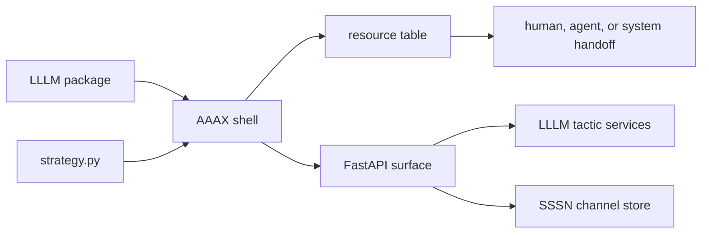

# Advanced Autonomous Agent Executor (AAAX)

<p class="psi-brand">
  
  
</p>

[aaax.one](https://aaax.one){ .psi-domain }

Advanced Autonomous Agent Executor (AAAX) is the strategy shell for
package-shaped agent systems, built on [LLLM](https://lllm.one/). It gives
packages a place to become useful: inspect a manifest, mount its tactics and
channels, bind local handlers, open a FastAPI surface, and hand the resulting
environment to a human, script, coding agent, or another system.

<div class="aaax-shell" aria-label="AAAX shell transcript">
  <span><span class="aaax-shell__prompt">$</span> aaax inspect packages/analyst-pack</span>
  <span><span class="aaax-shell__muted">analyst-pack:</span> Demo analyst package.</span>
  <span><span class="aaax-shell__ok">package</span> analyst-pack lllm://demo/analyst-pack</span>
  <span><span class="aaax-shell__ok">tactic</span> echo lllm://demo/analyst-pack/tactics/echo</span>
  <span><span class="aaax-shell__ok">channel</span> events lllm://demo/analyst-pack/channels/events</span>
  <span><span class="aaax-shell__prompt">$</span> aaax serve packages/analyst-pack --port 8400</span>
  <span><span class="aaax-shell__muted">Uvicorn running on</span> http://127.0.0.1:8400</span>
</div>

AAAX stays thin on purpose. LLLM owns tactics, services, and packages, from
the `lllm.toml` manifest to the hub; SSSN owns semantic channels; agent tools
own their reasoning loops. AAAX is the shell where those resources get named,
mounted, served, and passed along.

AAAX is LLLM-centric: a mounted tactic is an LLLM tactic served with LLLM's
tactic service, a package is an LLLM package, and installing AAAX adds
`lllm shell` to the `lllm` command. A `Strategy` can still be as small as a
resource table with a few local handlers; SSSN joins only when the strategy
has channels to store.

<div class="psi-tiles">
  <div class="psi-tile">
    <strong>Inspect</strong>
    Read a package or strategy and see the local command surface before serving it.
  </div>
  <div class="psi-tile">
    <strong>Mount</strong>
    Mount `lllm.toml` resources into one shell without erasing their `lllm://` refs.
  </div>
  <div class="psi-tile">
    <strong>Pipe</strong>
    Call tactics, append/query channels, and invoke resources through stable endpoints.
  </div>
  <div class="psi-tile">
    <strong>Handoff</strong>
    Preserve cards, docs, examples, assets, and service URLs for people and agents.
  </div>
</div>

## Fast Path

Serve a package (`lllm shell serve` is the same command):

```bash
aaax serve packages/analyst-pack --port 8400
```

Call a tactic:

```bash
curl -X POST http://127.0.0.1:8400/tactics/echo/run \
  -H 'content-type: application/json' \
  -d '{"input": {"text": "hello"}, "context": {"metadata": {"request": "demo"}}}'
```

Write and read a channel:

```bash
curl -X POST http://127.0.0.1:8400/channels/events/events \
  -H 'content-type: application/json' \
  -d '{"input": {"kind": "record", "payload": {"text": "hello"}}}'

curl 'http://127.0.0.1:8400/channels/events/events?limit=10'
```

## Shape



AAAX treats a package like something you mount into a shell session. The local
name can change, but the package ref remains stable. A caller can list what is
mounted, run one tactic, append an event, invoke a service, or call the shell's
top-level `/run` command. That caller can be a person, an app, an agent, or the
next system in a larger loop.

## What AAAX Owns

- `Strategy`, `StrategyResource`, and the shell's mounted resource table.
- Pydantic request, response, resource, and strategy description models.
- Loading `strategy.py`, `aaax.py`, `module:factory`, package folders, and
  direct `lllm.toml` files.
- Mounting LLLM package resources into one local namespace.
- Serving every mounted tactic with LLLM's tactic service.
- Backing channel resources with one SSSN store per strategy.
- Serving the shell through FastAPI, the `aaax` CLI, and `lllm shell`.

## What Stays Outside

- Tactic runtimes, LLM provider execution, tool policy, traces, and evals: LLLM.
- Package manifests, validation, publishing, and the hub: LLLM.
- Channel storage, subscriptions, and stream processing: SSSN.
- Durable production storage, deployment, queueing, and service orchestration.
- Coding-agent behavior itself. AAAX gives agents a shell surface; it does not
  decide how they reason.

## Next

- Start with [Getting Started](getting-started.md).
- Learn the model in [Strategies](concepts/strategies.md).
- Mount packages in [LLLM Packages](composition/packages.md).
- See how AAAX fits LLLM and SSSN in [Use with LLLM](guides/lllm.md).
- Serve your first package in [Serve A Package](tutorials/serve-package.md).
