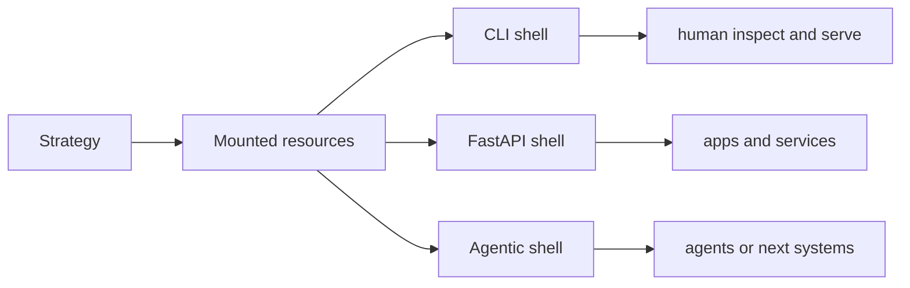

# Shell

Shell is the callable half of AAAX. After a package or strategy is loaded and
resources are mounted, AAAX exposes the same strategy through surfaces for
humans, applications, coding agents, and other systems.

## Shell Surfaces

- [CLI Shell](cli-shell.md): a human-facing command surface for inspecting,
  mounting, and serving packages, as `aaax` or `lllm shell`.
- [FastAPI Shell](fastapi-surface.md): an application-facing HTTP surface for
  `/run`, LLLM tactic services, channels, packages, resource invocation, and
  other systems that need to connect.
- [Agentic Shell](agent-handoff.md): an agent-facing context surface for Codex,
  Claude Code, IDE agents, and other coding-agent workflows.

## Operational Boundary

AAAX validates host, port, and log-level CLI inputs. It does not manage TLS,
replicas, queue workers, secrets, containers, or cloud deployment. Keep those in
the deployment layer and treat AAAX as the shell object that layer serves.

The strategy app has no authentication, and handlers and package code run in
the server process, so serve it on localhost or behind your own gateway. Names
and routes may still change between releases.
