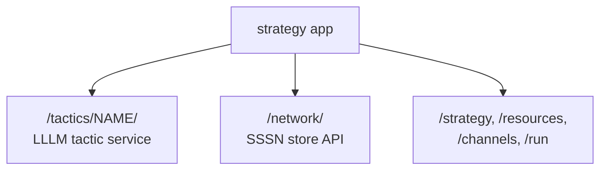

# Serving

`create_strategy_app(strategy)` turns a strategy into one FastAPI app. The
app adds no new protocol where one already exists: every tactic resource is
mounted as LLLM's own tactic service at `/tactics/<name>/`, an SSSN channel
store is mounted as SSSN's store API at `/network/`, and AAAX adds routes
only for what neither has, such as the resource table and the strategy's
`/run`. A client written for an LLLM tactic service or an SSSN store works
against a strategy unchanged.

```python title="desk.py"
from fastapi.testclient import TestClient
from lllm import Tactic

from aaax import Strategy, create_strategy_app


class Triage(Tactic):
    """Route a support ticket to a queue."""

    name = "triage"
    input_type = str

    def call(self, text: str) -> str:
        return "oncall" if "outage" in text.lower() else "support"


def summarize(text: str) -> str:
    """Keep the first sentence of a ticket."""
    return text.split(". ")[0] + "."


desk = Strategy("desk", description="Route and summarize tickets.")
desk.add_tactic(Triage())  # (1)!
desk.tactic("summarize", handler=summarize)


@desk.runner  # (2)!
async def handle(text: str) -> dict:
    tactics = desk.tactics()
    return {
        "queue": await tactics["triage"].arun(text),
        "summary": await tactics["summarize"].arun(text),
    }


client = TestClient(create_strategy_app(desk))  # (3)!
ticket = "Total outage in eu-west. It started at 9:00."
reply = client.post("/tactics/triage/run", json={"input": ticket}).json()
print(reply["output"], reply["tactic"])  # (4)!
#> oncall triage
print(client.post("/run", json={"input": ticket}).json())  # (5)!
"""
{
    'output': {'queue': 'oncall', 'summary': 'Total outage in eu-west.'},
    'strategy': 'desk',
    'metadata': {},
}
"""
```

1. Two tactic resources: an LLLM tactic, and a plain function that AAAX
   wraps with `lllm.as_tactic`. Both are served at `/tactics/<name>/`.
   Agent-backed tactics are served the same way
   ([Tactics](https://lllm.one/tactics/)).
2. The runner is the strategy's own operation, served at `POST /run`.
3. Building the app mounts the tactics and opens the channel store, if
   there is one. `TestClient` calls the app in this process.
4. `/tactics/triage/run` is LLLM's tactic service, with its envelope:
   `output`, `request_id`, and `tactic`.
5. The strategy's routes use AAAX's envelope: `output`, `strategy`, and
   `metadata`.



## Routes

| Route | Does |
| --- | --- |
| `GET /health` | `{"ok": true, "strategy": NAME}` |
| `GET /strategy` | The `StrategyInfo`: name, description, resources, metadata |
| `GET /resources`, `/tactics`, `/channels`, `/packages` | Resource records: all of them, or those of one kind |
| `POST /run` | Calls the strategy's runner |
| `POST /resources/{name}/invoke` | Calls one resource by name |
| `GET`, `POST /channels/{name}/events` | Reads or appends a channel's events ([Channels](channels.md)) |
| `POST /tactics/{name}/run`, `/stream`; `GET /tactics/{name}/info` | LLLM's tactic service, one per tactic resource |
| `/network/...` | SSSN's store API, when the store is an SSSN store |
| `GET /docs`, `/openapi.json` | FastAPI's docs for the strategy's own routes |

Each mounted app keeps its own docs: `/tactics/<name>/docs` and
`/tactics/<name>/openapi.json` carry a tactic's schemas, and `/network/docs`
documents the store API. `GET /tactics` lists the tactic resource records,
including tactics declared without a handler, which have no service. Names
keep their dots, as in `/tactics/support.triage/run`. A name under
`/tactics/` that is not mounted gets Starlette's plain 404, `{"detail":
"Not Found"}`.

## Tactic routes

`/tactics/<name>/` is `create_tactic_app(tactic)` from LLLM, mounted as
is, so everything in LLLM's [Serving](https://lllm.one/serving/) guide
holds there. `run` and `stream` (server-sent events, for a tactic that
streams) take a `POST`, `info` returns the input and output schemas, and
the tactic's [custom endpoints](https://lllm.one/serving/#custom-endpoints)
sit under the same prefix: an endpoint at `/explain` is served at
`/tactics/<name>/explain`.

`strategy.tactics()` decides what is mounted. A `Tactic` is served as is,
a package tactic is imported when the app is built, and a plain function
is wrapped with `lllm.as_tactic`, so its annotations become the schemas.
Each one is served under its local name, so the `tactic` field of replies
and errors names the route, as in `/tactics/support.triage/run`. A tactic
that `add_tactic(name=...)` or a package prefix renamed is served as a
copy with that name; the tactic you mounted keeps its own.

Requests use LLLM's envelope, `{"input": ..., "context": {...}}`, and the
`context` becomes the `CallContext` a tactic receives. A tactic declares a
`context` parameter to read it:

```python title="context.py"
from fastapi.testclient import TestClient
from lllm import Tactic

from aaax import Strategy, create_strategy_app


class Lookup(Tactic):
    """Look up an order."""

    name = "lookup"
    input_type = str

    def call(self, order_id: str, *, context=None) -> dict:
        return {
            "order": order_id,
            "trace": context.trace_id,
            "user": context.metadata["user"],
        }


def audit(entry: dict, context=None) -> dict:  # (1)!
    return {"saw": sorted(context)}


shop = Strategy("shop").add_tactic(Lookup())
shop.service("audit", handler=audit)
client = TestClient(create_strategy_app(shop))
context = {
    "request_id": "req-7",
    "trace_id": "trace-42",
    "metadata": {"user": "ada"},
    "shard": 3,  # (2)!
}

body = {"input": "A-1001", "context": context}
reply = client.post("/tactics/lookup/run", json=body).json()
print(reply["output"], reply["request_id"])
#> {'order': 'A-1001', 'trace': 'trace-42', 'user': 'ada'} req-7
reply = client.post("/resources/lookup/invoke", json=body).json()
print(reply["output"])  # (3)!
#> {'order': 'A-1001', 'trace': 'trace-42', 'user': 'ada'}

body = {"input": {"note": "refund"}, "context": context}
print(client.post("/resources/audit/invoke", json=body).json()["output"])
#> {'saw': ['metadata', 'request_id', 'shard', 'trace_id']}
```

1. A handler that is not a tactic, here a service, gets the `context`
   object as a plain dict, every key included.
2. `CallContext` has no `shard` field, so a tactic never sees it. Put your
   own values in `metadata`.
3. A tactic resource runs the same way through the strategy's
   `/resources/{name}/invoke`, with the same `CallContext`.

| `CallContext` field | Meaning |
| --- | --- |
| `request_id` | The call's id; generated when missing, and returned as the reply's `request_id` |
| `trace_id`, `span_id`, `caller` | Tracing ids and who is calling |
| `tags` | String labels, such as `{"env": "prod"}` |
| `metadata` | Your own values: any JSON object |
| `tactic_ref` | Defaults to the tactic's `package_ref`; a package tactic's is its manifest ref |
| `package_ref`, `service_ref` | Refs the caller passes along |
| `endpoint` | Set by the service: `run`, `stream`, or a custom endpoint's name |

Unknown keys are ignored, and a `context` that is not an object, or has
`metadata` or `tags` that are not objects, is a 400 `SchemaError`. As in
any LLLM service, a body that is not an envelope is taken as the input
itself, and `task` works in place of `input`; the strategy's own routes,
below, take only the envelope.

## The strategy's routes

`/run`, `/resources/{name}/invoke`, and `/channels/{name}/events` take a
`StrategyRunRequest`, `{"input": ..., "context": {...}}`, and answer with a
`StrategyRunResponse`:

```json
{
  "output": {"queue": "oncall"},
  "strategy": "desk",
  "metadata": {"resource": "triage", "endpoint": "resource"}
}
```

`metadata` names the resource and the route (`resource` or `channel`), and
is empty for `/run`. Other keys in the body are ignored, so a body without
`input` runs with the input `None`.
`/resources/{name}/invoke` does what the resource calls for:

| Resource | `/resources/{name}/invoke` |
| --- | --- |
| A tactic with a handler | Runs it as `/tactics/{name}/run` does, with a `CallContext` |
| A channel backed by the store | A store operation, chosen by `op` in the input ([Channels](channels.md#append-and-read-events)) |
| Anything else with a handler | Calls the handler with the input, and with `context` as a dict if it takes one |
| Anything without a handler | Echoes the resource record, the input, and the context |

The runner follows the handler rule, and a strategy without a runner
answers `/run` with its name, the input, and its resources. How handlers
are called, sync or async, with or without the input, is in
[Resources](resources.md).

## Errors

The strategy's routes report failures in the error envelope that LLLM's
tactic services use, under FastAPI's `detail` key:

```python title="errors.py"
from fastapi import HTTPException
from fastapi.testclient import TestClient

from aaax import Strategy, create_strategy_app


def refund(order: dict) -> dict:
    if order["amount"] > 100:
        raise ValueError("refunds over 100 need a manager")
    if order["amount"] <= 0:
        raise HTTPException(status_code=403, detail="Not allowed.")
    return {"refunded": order["amount"]}


shop = Strategy("shop").service("refund", handler=refund)
client = TestClient(create_strategy_app(shop))

response = client.post("/resources/nope/invoke", json={"input": 1})
error = response.json()["detail"]["error"]
print(response.status_code, error["type"], error["metadata"])
#> 404 ResourceNotFoundError {'resource': 'nope'}
print(sorted(error))
#> ['endpoint', 'message', 'metadata', 'request_id', 'tactic', 'type']

body = {"input": {"amount": 500}}
response = client.post("/resources/refund/invoke", json=body)
error = response.json()["detail"]["error"]
print(response.status_code, error["type"], error["message"])
#> 400 ValueError refunds over 100 need a manager

body = {"input": {"amount": 0}}
response = client.post("/resources/refund/invoke", json=body)
print(response.status_code, response.json())  # (1)!
#> 403 {'detail': 'Not allowed.'}
```

1. A handler that raises an `HTTPException` decides the response itself:
   its status and its `detail`, without the envelope.

| Status | When, on the strategy's routes |
| --- | --- |
| 400 | A body that does not validate (`SchemaError`), an appended event whose `input` is not an object, or a `ValueError`, `SchemaError`, or `TacticUnsupportedError` from the runner or a handler |
| 404 | The URL names no resource, or a `/channels/` route names one that is not a channel (`ResourceNotFoundError`) |
| 404, 409, 400 | A channel store error, with SSSN's codes: not found, conflict, anything else |
| Its own | An `HTTPException` from the runner or a handler |
| 500 | Anything else the runner or a handler raises |

A tactic fails the same way on both of its routes, with LLLM's codes: 400
for `SchemaError` and `TacticUnsupportedError`, 500 for anything else,
`ValueError` and `HTTPException` included. On `/tactics/...` the error
carries the tactic's name and the `request_id`; on the strategy's routes
`metadata.resource` names the resource. SSSN's routes under `/network/`
use the same envelope with only `type` and `message`.

## Serve from the command line

`aaax serve` loads a strategy and runs its app with Uvicorn; `aaax inspect`
prints what would be served, without importing package code or opening the
store. A strategy file defines `build_strategy()` or a module-level
`strategy`:

```python title="strategy.py"
from aaax import Strategy


def triage(text: str) -> str:
    """Route a support ticket to a queue."""
    return "oncall" if "outage" in text.lower() else "support"


def build_strategy() -> Strategy:
    desk = Strategy("desk", description="Route support tickets.")
    ref = "lllm://acme/desk/tactics/triage"
    desk.tactic("triage", handler=triage, ref=ref)
    desk.channel("tickets", description="Support tickets.")
    return desk
```

```text
$ aaax inspect strategy.py
desk: Route support tickets.
tactic triage lllm://acme/desk/tactics/triage
channel tickets
$ aaax serve strategy.py
INFO:     Uvicorn running on http://127.0.0.1:8400 (Press CTRL+C to quit)
```

Each line of `inspect` is a resource's kind, name, and ref (or
entrypoint), and `--json` prints the whole `StrategyInfo`. `lllm shell
serve` and `python -m aaax serve` are the same command as `aaax serve`,
and `aaax launch` is another name for it.

| Target | Loads |
| --- | --- |
| A `.py` file | Its `build_strategy()`, or else its `strategy` |
| A folder | `strategy.py`, else `shell.py`, else the package in `lllm.toml` |
| `lllm.toml` | The package, as a strategy named after it |
| `module:attribute` | A `Strategy`, or a function without parameters that returns one, imported from the working directory |

`--host` defaults to `127.0.0.1` and must be a host name or address, not a
URL or `host:port`. `--port` defaults to 8400 (LLLM's `lllm serve` uses
8000). `--log-level` is one of `critical`, `debug`, `error`, `info` (the
default), `trace`, or `warning`. A bad option, a target that does not load,
or a strategy whose store needs a missing SSSN stops the command with exit
status 2 and a message. The [CLI reference](api/cli.md) lists every option.

## Your own server

`create_strategy_app` returns a plain FastAPI app, titled with the
strategy's name and description and versioned with AAAX's version; the
strategy is at `app.state.aaax_strategy`. To choose the server or wrap the
app, put `app = create_strategy_app(build_strategy())` in a module and run
it with any ASGI server, as in `uvicorn app:app`.

The app has no authentication, and handlers and package code run in the
server process, so serve it on localhost or behind a gateway. Middleware on
the strategy app also covers the mounted tactic services and `/network/`,
so one check guards every route; LLLM's
[Authentication](https://lllm.one/serving/#authentication) section has a
bearer-token middleware that works here unchanged. AAAX does not manage
TLS, replicas, workers, secrets, or deployment; those belong to whatever
runs the app.
